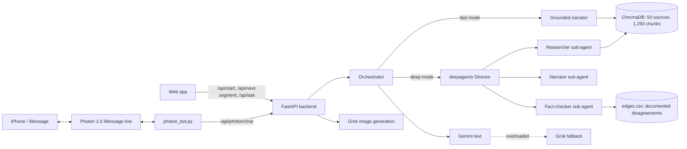

# Vantage: Backend Architecture

Vantage is an interactive documentary engine. A viewer picks a story (the Battle of Princeton or the sinking of the Titanic), chooses perspectives, and asks questions. Every segment is grounded in real sources, and Vantage points out where those sources disagree. The same brain also lives on iMessage, and a viewer can move between the web and their phone without losing their place.

## System overview

## Knowledge layer

- **Sources:** 34 documents on Princeton and 21 on the Titanic, curated in `data/documents.csv` with perspective, date, source type, and map coordinates. Primary sources include Washington's letters to Congress, Howe's report in the London Gazette, the US Senate and British inquiry testimony, and survivor memoirs by Lawrence Beesley and Archibald Gracie.
- **Disagreements:** `data/edges.csv` records where sources contradict each other (for example, whether General Mercer was dead or alive, British vs. American casualty counts, and whether the Titanic broke in two).
- **Ingest:** `knowledge/ingest.py` chunks each source and loads it into ChromaDB with its topic, perspective, source type, and location on every chunk. Retrieval always filters by topic, so a Titanic question never pulls Princeton text.
- **Perspectives:** Princeton uses `american`, `british`, `townspeople`; the Titanic uses `crew`, `first_class`, `steerage`; both use `narrator` and `historian`.

## Two agent modes

**Fast mode (default, about 5 seconds).** The orchestrator retrieves the five most relevant unseen chunks for the viewer's choice or question, filtered to the chosen perspective, and the narrator writes one grounded segment as structured JSON: narration, mood, perspective, scene prompt, map location, source ids, and the next choices.

**Deep mode (about 12 seconds, LangChain deepagents).** A Director agent plans the segment and delegates to three sub-agents:

1. **Researcher** searches the source library (up to six searches) and returns facts tagged with source ids.
2. **Narrator** turns those facts into spoken narration.
3. **Fact-checker** re-searches the sources, checks for documented disagreements with `find_contradictions`, and flags unsupported claims.

The Director applies the corrections and returns a structured segment. If deep mode fails for any reason, the request falls back to fast mode automatically. Switch with `VANTAGE_AGENT_MODE=fast|deep` in `.env`.

## Contradictions

After a segment is written, the orchestrator looks up documented disagreements in `edges.csv` that touch the segment's sources and are relevant to what the narration actually says. One is attached to the segment as `contradiction`, with both sides and their source ids, and is never shown twice in the same session.

## iMessage on Photon 2.0

`photon_bot.py` polls the project's iMessage line through the Photon 2.0 Python client and sends each new message to `/api/photon/chat`. The bot supports:

- **Q&A:** short, grounded answers with a "Sources:" line and a follow-up question
- **Topic switching:** text TITANIC or PRINCETON
- **Intro:** "what is this?" explains Vantage

## Cross-channel continuity

Every web session gets a 4-digit `link_code`. When a viewer texts `VANTAGE 1808` to the Vantage number, their phone joins that same session:

- The bot replies with how many segments they have watched and the choices they were looking at
- Replying `1`, `2`, or `3` (or `NEXT`) continues the documentary on the phone
- Free-form questions become new segments in the same story
- Everything created on the phone appears in `/api/graph`, so the web knowledge graph shows it too
- `UNLINK` disconnects

## Reliability

- **Model fallback:** Gemini 3.8 Flash, then Gemini 3.5 Flash, then Grok. Each Gemini call times out after 20 seconds, and after a failure Gemini is skipped for two minutes.
- **Mock fallback:** if every model fails, the orchestrator serves pre-written, source-grounded segments for each topic, so the demo never breaks.
- **Validation:** every model output is cleaned against the shared enums (perspective, mood, choice type) before it reaches the frontend.

## API

| Method | Path | Purpose |
| --- | --- | --- |
| POST | `/api/start` | Start a session; returns the first segment and a `link_code` |
| POST | `/api/next-segment` | Continue with a chosen `choice_id` |
| POST | `/api/ask` | Ask a free-form question |
| GET | `/api/sources` | Sources used so far in the session |
| GET | `/api/graph` | Knowledge graph nodes and edges |
| POST | `/api/photon/chat` | iMessage replies (used by `photon_bot.py`) |
| GET | `/api/health` | Health check |

## Run it

    cd backend
    python -m venv .venv && source .venv/bin/activate
    pip install -r requirements.txt
    cd ../data && python fetch_sources.py --priority P1 && python fetch_sources.py --priority P2
    cd ../backend && python -m knowledge.ingest
    uvicorn main:app --port 8000      # window 1
    python photon_bot.py              # window 2, iMessage agent

Keys go in `.env` (see `.env.example`): `GEMINI_API_KEY`, `XAI_API_KEY`, `PHOTON_API_KEY`, `PHOTON_PROJECT_ID`.

## Built with

FastAPI, ChromaDB, Google Gemini, xAI Grok (fallback text and image generation), LangChain deepagents, and Photon 2.0 (iMessage).
